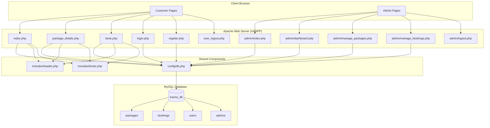
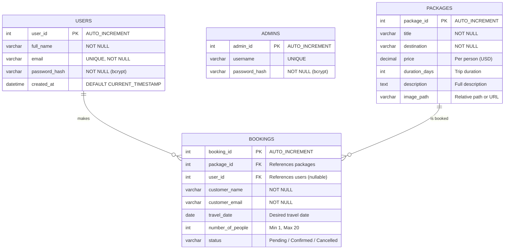
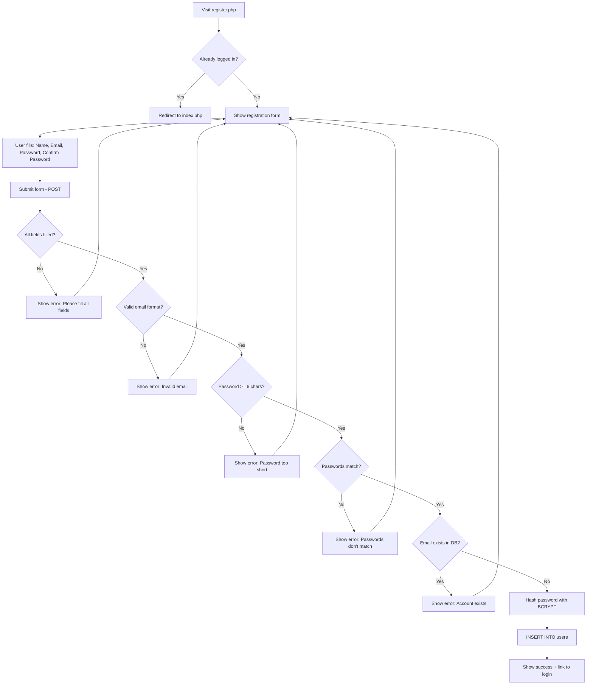
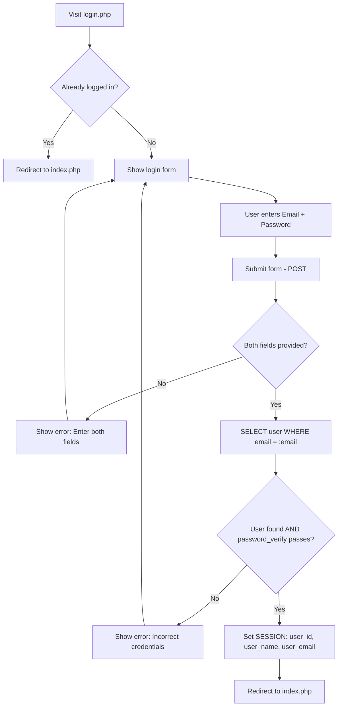
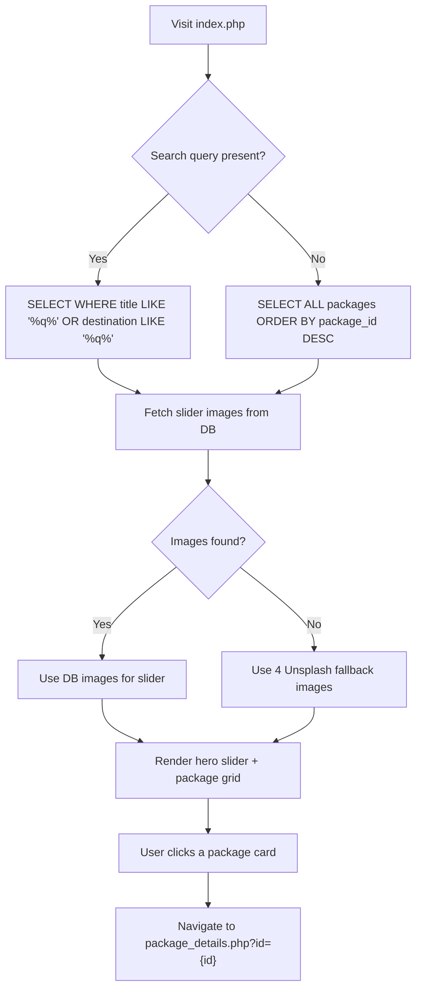
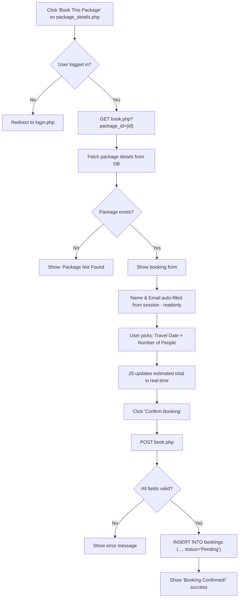
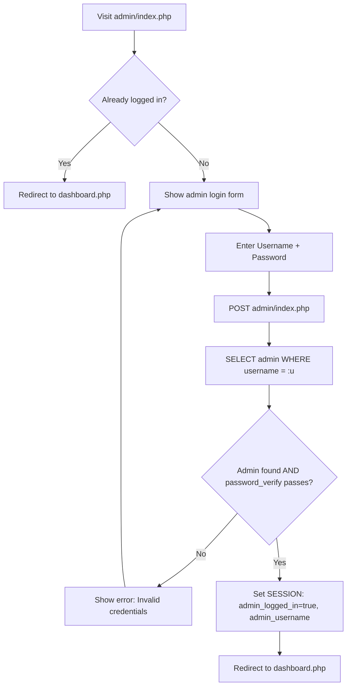
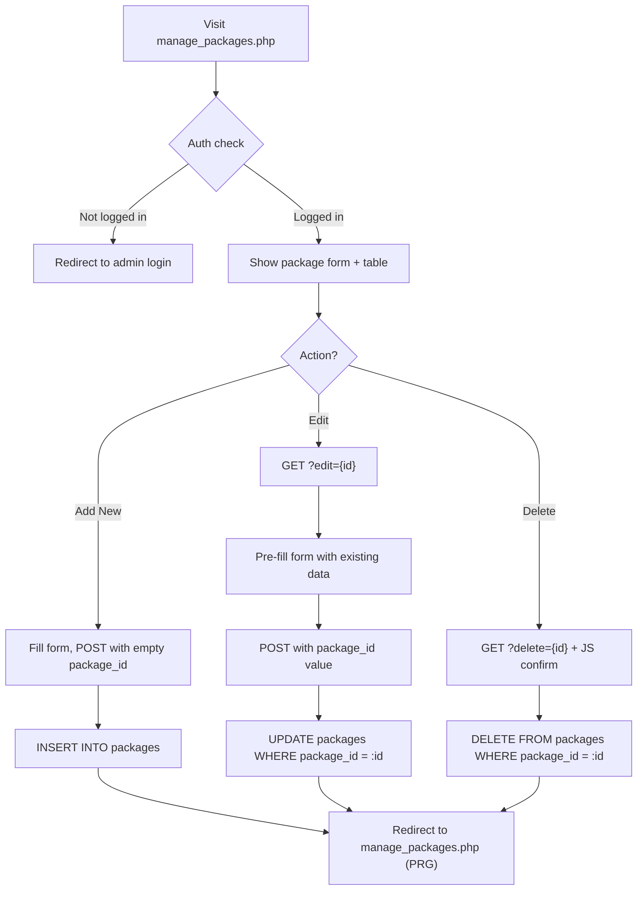
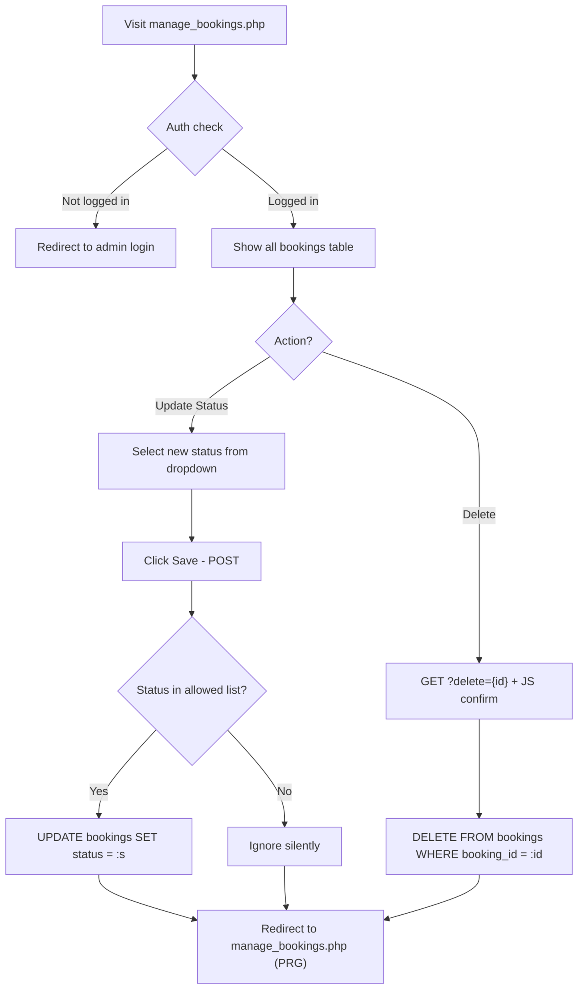

# ✈️ TRAVIRA — Travel Explorer & Booking System
## Complete Project Report (Minor Project)

> **Submitted By:** _[Your Name]_
> **Date:** October 2026
> **Subject:** _[Subject Name]_
> **Guided By:** _[Professor Name]_

---

## 📋 Table of Contents

1. [Introduction & Objective](#1-introduction--objective)
2. [Technology Stack](#2-technology-stack)
3. [System Architecture](#3-system-architecture)
4. [Project Directory Structure](#4-project-directory-structure)
5. [Database Design](#5-database-design)
6. [Module-Wise Detailed Explanation](#6-module-wise-detailed-explanation)
   - 6.1 [Database Connection Module](#61-database-connection-module)
   - 6.2 [Shared Layout Module (Header & Footer)](#62-shared-layout-module-header--footer)
   - 6.3 [Homepage & Package Browsing Module](#63-homepage--package-browsing-module)
   - 6.4 [Package Details Module](#64-package-details-module)
   - 6.5 [User Registration Module](#65-user-registration-module)
   - 6.6 [User Login Module](#66-user-login-module)
   - 6.7 [User Logout Module](#67-user-logout-module)
   - 6.8 [Booking Module](#68-booking-module)
   - 6.9 [Admin Login Module](#69-admin-login-module)
   - 6.10 [Admin Dashboard Module](#610-admin-dashboard-module)
   - 6.11 [Admin Package Management Module (CRUD)](#611-admin-package-management-module-crud)
   - 6.12 [Admin Booking Management Module](#612-admin-booking-management-module)
   - 6.13 [Admin Logout Module](#613-admin-logout-module)
7. [Complete User Workflows (Flowcharts)](#7-complete-user-workflows)
8. [Session Management Architecture](#8-session-management-architecture)
9. [Security Implementations](#9-security-implementations)
10. [Styling & Design System](#10-styling--design-system)
11. [External Dependencies](#11-external-dependencies)
12. [Setup & Installation Guide](#12-setup--installation-guide)
13. [Screenshots & Output](#13-screenshots--output)
14. [Future Enhancements](#14-future-enhancements)
15. [Conclusion](#15-conclusion)

---

## 1. Introduction & Objective

### 1.1 What is Travira?

**Travira** is a full-stack web-based travel booking system built using PHP and MySQL. It allows customers to browse travel packages, register an account, log in, view package details, and book their desired trips. An admin panel is provided separately for the site administrator to manage all packages and bookings.

### 1.2 Objective

The primary objective of this project is to develop a functional, secure, and visually appealing travel booking web application that demonstrates:

- **Full-Stack Web Development** — PHP backend with MySQL database
- **CRUD Operations** — Create, Read, Update, Delete operations for packages and bookings
- **User Authentication** — Secure registration and login with password hashing
- **Session Management** — Separate customer and admin sessions
- **Security Best Practices** — SQL injection prevention, XSS protection, input validation
- **Modern UI/UX Design** — Responsive layout with glassmorphism, animations, and a professional look

### 1.3 Scope

The system has **two user roles**:

| Role       | Capabilities |
|------------|-------------|
| **Customer** | Register, login, browse packages, search, view details, book packages, logout |
| **Admin**    | Login to admin portal, view dashboard statistics, manage packages (add/edit/delete), manage bookings (update status/delete), logout |

---

## 2. Technology Stack

| Layer          | Technology                        | Purpose |
|----------------|-----------------------------------|---------|
| **Web Server** | Apache (via XAMPP)                | Serves PHP files and handles HTTP requests |
| **Backend**    | PHP 7.4+ (Procedural + PDO)       | Server-side logic, form handling, database queries |
| **Database**   | MySQL (via XAMPP / phpMyAdmin)    | Stores packages, bookings, users, admins |
| **Frontend**   | HTML5, Vanilla CSS, Vanilla JS   | Page structure, styling, client-side interactivity |
| **Icons**      | Font Awesome 6.4.0 (CDN)         | UI icons (navbar, admin panel, stat cards) |
| **Fonts**      | Google Fonts — Inter (CDN)       | Clean, modern typography |
| **Email**      | PHPMailer Library (bundled)       | Email notification support (library included) |

> **Key Point:** The project uses **no npm, no Composer, and no build tools**. All dependencies are loaded directly from CDNs at runtime, making deployment straightforward.

---

## 3. System Architecture

### 3.1 Architecture Pattern: Multi-Page Application (MPA)

Travira follows a **traditional multi-page PHP architecture** where each URL corresponds to a separate `.php` file. The server processes each request, queries the database, and returns fully-rendered HTML.

### 3.2 Architecture Diagram



### 3.3 Request-Response Flow

```
Browser Request (GET/POST)
    │
    ▼
Apache Web Server receives the request
    │
    ▼
PHP Engine processes the .php file
    │
    ├── require_once 'config/db.php'     → Establishes PDO connection to MySQL
    ├── require_once 'includes/header.php' → Starts session + outputs navbar
    ├── [Business Logic]                  → Queries database, processes form data
    ├── [HTML Output]                     → Generates the page HTML
    └── require_once 'includes/footer.php' → Closes HTML tags
    │
    ▼
HTML Response sent back to browser
```

---

## 4. Project Directory Structure

```
php/                                  ← Project root (served at localhost/php/)
│
├── index.php                         ← Homepage: hero slider + package listing + search
├── package_details.php               ← Single package detail view with booking CTA
├── book.php                          ← Booking form page (requires login)
├── login.php                         ← Customer login page
├── register.php                      ← Customer registration page
├── user_logout.php                   ← Customer logout handler
│
├── config/
│   └── db.php                        ← PDO database connection (singleton)
│
├── includes/
│   ├── header.php                    ← Shared <head>, navbar, session start
│   └── footer.php                    ← Shared <footer>, closing </body></html>
│
├── admin/
│   ├── index.php                     ← Admin login page
│   ├── dashboard.php                 ← Admin dashboard with statistics
│   ├── manage_packages.php           ← Package CRUD (Add / Edit / Delete)
│   ├── manage_bookings.php           ← Booking management (status / delete)
│   └── logout.php                    ← Admin logout handler
│
├── css/
│   ├── style.css                     ← Main stylesheet (~2000 lines, full design system)
│   └── admin.css                     ← Admin-only style overrides
│
├── sql/
│   └── create_users_table.sql        ← SQL migration for users table + FK
│
├── images/
│   ├── ui/
│   │   ├── travira_logo.png          ← Brand logo
│   │   ├── new_sky_bg.jpg            ← Sky background for auth pages
│   │   ├── admin_bg.jpg              ← Admin background image
│   │   ├── auth_sky_bg.png           ← Alternate auth background
│   │   └── hero-section.jpg          ← Hero section fallback
│   └── packages/
│       ├── alps.jpg                  ← Swiss Alps package image
│       ├── bali.jpg                  ← Bali package image
│       ├── dubai.jpg                 ← Dubai package image
│       ├── iceland.png               ← Iceland package image
│       ├── itali.jpg                 ← Italy package image
│       ├── japan.png                 ← Japan package image
│       ├── machupicchu.png           ← Machu Picchu package image
│       ├── maldives.png              ← Maldives package image
│       ├── newyork.png               ← New York package image
│       ├── paris.png                 ← Paris package image
│       ├── safari.png                ← Safari package image
│       ├── santorini.png             ← Santorini package image
│       └── thailand.png              ← Thailand package image
│
├── phpmailer/                        ← PHPMailer library (bundled for email support)
│   ├── src/                          ← PHPMailer source code
│   ├── language/                     ← PHPMailer language files
│   ├── composer.json                 ← PHPMailer package metadata
│   └── ...
│
└── Readme.md                         ← Project documentation
```

**Total Files:** 17 PHP files + 2 CSS files + 1 SQL file + 18 image assets + PHPMailer library

---

## 5. Database Design

### 5.1 Database Name: `travira_db`

The database consists of **4 tables** with foreign key relationships.

### 5.2 Entity-Relationship Diagram



### 5.3 Table Details

#### Table: `packages`

| Column          | Data Type       | Constraints               | Description                            |
|-----------------|-----------------|---------------------------|----------------------------------------|
| `package_id`    | INT             | PRIMARY KEY, AUTO_INCREMENT | Unique identifier for each package     |
| `title`         | VARCHAR         | NOT NULL                  | Package name (e.g., "Tropical Beaches")|
| `destination`   | VARCHAR         | NOT NULL                  | Destination location (e.g., "Bali")    |
| `price`         | DECIMAL / FLOAT | NOT NULL                  | Price per person in USD                |
| `duration_days` | INT             | NOT NULL                  | Trip duration in days                  |
| `description`   | TEXT            | —                         | Full trip description/itinerary        |
| `image_path`    | VARCHAR         | —                         | Relative path to package image         |

#### Table: `bookings`

| Column             | Data Type | Constraints                | Description                          |
|--------------------|-----------|----------------------------|--------------------------------------|
| `booking_id`       | INT       | PRIMARY KEY, AUTO_INCREMENT | Unique booking identifier            |
| `package_id`       | INT       | FOREIGN KEY → packages     | Which package was booked             |
| `user_id`          | INT       | FOREIGN KEY → users (NULL) | Which user booked (NULL for guests)  |
| `customer_name`    | VARCHAR   | NOT NULL                   | Customer's full name                 |
| `customer_email`   | VARCHAR   | NOT NULL                   | Customer's email address             |
| `travel_date`      | DATE      | NOT NULL                   | Desired travel date                  |
| `number_of_people` | INT       | NOT NULL                   | Number of travelers (1–20)           |
| `status`           | VARCHAR   | DEFAULT 'Pending'          | Pending / Confirmed / Cancelled      |

#### Table: `users`

| Column          | Data Type    | Constraints                  | Description                       |
|-----------------|--------------|------------------------------|-----------------------------------|
| `user_id`       | INT          | PRIMARY KEY, AUTO_INCREMENT  | Unique user identifier            |
| `full_name`     | VARCHAR(120) | NOT NULL                     | Customer's full name              |
| `email`         | VARCHAR(180) | UNIQUE, NOT NULL             | Login identifier (must be unique) |
| `password_hash` | VARCHAR(255) | NOT NULL                     | Bcrypt hash of the password       |
| `created_at`    | DATETIME     | DEFAULT CURRENT_TIMESTAMP    | Account creation timestamp        |

#### Table: `admins`

| Column          | Data Type    | Constraints                 | Description                    |
|-----------------|--------------|-----------------------------|---------------------------------|
| `admin_id`      | INT          | PRIMARY KEY, AUTO_INCREMENT | Unique admin identifier         |
| `username`      | VARCHAR      | UNIQUE                      | Admin login username            |
| `password_hash` | VARCHAR(255) | NOT NULL                    | Bcrypt hash of admin password   |

### 5.4 SQL Migration File

**File:** `sql/create_users_table.sql`

This migration file is run once in phpMyAdmin to:
1. **Create the `users` table** with `user_id`, `full_name`, `email`, `password_hash`, and `created_at` columns
2. **Add a `user_id` foreign key column** to the existing `bookings` table, linking bookings to registered users

```sql
CREATE TABLE IF NOT EXISTS `users` (
    `user_id`       INT          NOT NULL AUTO_INCREMENT,
    `full_name`     VARCHAR(120) NOT NULL,
    `email`         VARCHAR(180) NOT NULL,
    `password_hash` VARCHAR(255) NOT NULL,
    `created_at`    DATETIME     NOT NULL DEFAULT CURRENT_TIMESTAMP,
    PRIMARY KEY (`user_id`),
    UNIQUE KEY `uq_user_email` (`email`)
) ENGINE=InnoDB DEFAULT CHARSET=utf8mb4;

ALTER TABLE `bookings`
    ADD COLUMN `user_id` INT NULL DEFAULT NULL AFTER `package_id`,
    ADD CONSTRAINT `fk_bookings_user`
        FOREIGN KEY (`user_id`) REFERENCES `users`(`user_id`)
        ON DELETE SET NULL;
```

> **Design Decision:** `user_id` in `bookings` is **nullable** — existing guest bookings remain unaffected. `ON DELETE SET NULL` ensures that if a user account is deleted, their bookings are preserved (just de-linked).

---

## 6. Module-Wise Detailed Explanation

---

### 6.1 Database Connection Module

| Property | Value |
|----------|-------|
| **File** | `config/db.php` |
| **Lines** | 19 lines |
| **Purpose** | Establishes a single PDO connection shared across all pages |

#### How It Works (Code-Level):

```php
$host = 'localhost';
$dbname = 'travira_db';
$username = 'root';
$password = '';

$pdo = new PDO("mysql:host=$host;dbname=$dbname;charset=utf8", $username, $password);
$pdo->setAttribute(PDO::ATTR_ERRMODE, PDO::ERRMODE_EXCEPTION);
```

**Step-by-step:**
1. Defines connection parameters (`localhost`, `travira_db`, `root`, empty password — XAMPP defaults)
2. Creates a `PDO` object with MySQL DSN string, specifying `charset=utf8`
3. Sets error mode to `ERRMODE_EXCEPTION` — any database error throws a `PDOException` that can be caught with try-catch
4. If connection fails, `die()` is called with the error message
5. The `$pdo` variable becomes available in any file that includes `config/db.php`

**Why PDO?**
- Supports **prepared statements** — prevents SQL injection
- Works with multiple databases (MySQL, PostgreSQL, SQLite)
- Better error handling with exceptions

---

### 6.2 Shared Layout Module (Header & Footer)

#### 6.2.1 Header — `includes/header.php`

| Property | Value |
|----------|-------|
| **File** | `includes/header.php` |
| **Lines** | 47 lines |
| **Included By** | `index.php`, `package_details.php`, `book.php` |

**Responsibilities:**
1. **Starts PHP session** (`session_start()`) if not already active — this is the central session initializer for all customer pages
2. Outputs `<!DOCTYPE html>`, `<html>`, `<head>` with:
   - `charset="UTF-8"` and responsive viewport meta tag
   - Page title: "Travira | Explore • Connect • Experience"
   - Links to `css/style.css` (main stylesheet)
   - Font Awesome 6.4.0 CDN link for icons
3. **Renders the navigation bar** with conditional logic:

```php
<!-- Conditional navigation based on login state -->
<?php if (isset($_SESSION['user_id'])): ?>
    <!-- Show logout button with user's name -->
    <a href="user_logout.php" class="nav-logout-btn">
        <i class="fa-solid fa-right-from-bracket"></i>
        <?php echo htmlspecialchars($_SESSION['user_name']); ?>
    </a>
<?php else: ?>
    <!-- Show login button -->
    <a href="login.php" class="nav-login-btn">Login</a>
<?php endif; ?>
```

**Navbar elements:**
- Logo (image) → links to `index.php`
- "Home" link → `index.php`
- Login/Logout button (conditional on `$_SESSION['user_id']`)
- "Admin Portal" button → `admin/index.php` (always visible)

#### 6.2.2 Footer — `includes/footer.php`

| Property | Value |
|----------|-------|
| **File** | `includes/footer.php` |
| **Lines** | 6 lines |

Renders a `<footer>` with dynamic copyright year:
```php
<p>&copy; <?php echo date('Y'); ?> Travira &mdash; Minor Project. All rights reserved.</p>
```
Then closes `</body>` and `</html>` tags.

---

### 6.3 Homepage & Package Browsing Module

| Property | Value |
|----------|-------|
| **File** | `index.php` |
| **Lines** | 179 lines |
| **URL** | `http://localhost/php/` or `http://localhost/php/index.php` |

#### Features:
1. **Hero Image Slider** — Full-screen rotating background images
2. **Search Functionality** — Filter packages by title or destination
3. **Package Cards Grid** — Visual listing of all travel packages

#### Code-Level Breakdown:

**Step 1 — Include dependencies:**
```php
require_once 'config/db.php';      // Database connection ($pdo)
require_once 'includes/header.php'; // Session + navbar
```

**Step 2 — Handle search query:**
```php
$query = trim($_GET['query'] ?? '');

if ($query) {
    // Search by title OR destination using LIKE with wildcards
    $sql = "SELECT package_id, title, destination, price, image_path 
            FROM Packages
            WHERE title LIKE :q OR destination LIKE :q
            ORDER BY package_id DESC";
    $stmt = $pdo->prepare($sql);
    $stmt->execute([':q' => '%' . $query . '%']);
} else {
    // No search — fetch ALL packages
    $sql = "SELECT package_id, title, destination, price, image_path 
            FROM Packages ORDER BY package_id DESC";
    $stmt = $pdo->query($sql);
}
$packages = $stmt->fetchAll(PDO::FETCH_ASSOC);
```

> **How Search Works:** The user types in the hero search bar or navbar. The form submits via GET to `index.php?query=XYZ`. PHP reads the `query` parameter and builds a `LIKE '%XYZ%'` SQL query that searches both the `title` and `destination` columns. Results are displayed in the same grid below.

**Step 3 — Fetch slider images:**
```php
$sliderStmt = $pdo->query("SELECT image_path, destination FROM Packages 
                           WHERE image_path IS NOT NULL AND image_path != '' 
                           ORDER BY package_id DESC LIMIT 5");
$sliderImages = $sliderStmt->fetchAll(PDO::FETCH_ASSOC);
```

If no images exist in the database, **4 Unsplash fallback images** are used (Paris, Maldives, Dubai, Swiss Alps).

**Step 4 — Hero Slider HTML:**
- Full-viewport section (`.hero-slider`) with CSS `background-image` slides
- Overlay gradient for text readability
- Centered heading: "Discover your next great adventure"
- Floating search bar form (submits to `index.php` via GET)
- Prev/Next arrow buttons
- Dot indicators (generated dynamically via JavaScript)

**Step 5 — Package Cards Grid:**
```php
<?php foreach ($packages as $pkg): ?>
    <a href="package_details.php?id=<?php echo $pkg['package_id']; ?>" class="modern-card">
        <div class="card-image-wrapper">
            "
                 alt="<?php echo htmlspecialchars($pkg['title']); ?>">
            <div class="price-badge">
                <strong>$<?php echo htmlspecialchars($pkg['price']); ?></strong>
            </div>
        </div>
        <div class="card-body">
            <span class="location-tag">📍 <?php echo htmlspecialchars($pkg['destination']); ?></span>
            <h3><?php echo htmlspecialchars($pkg['title']); ?></h3>
            <p class="card-link">Explore package →</p>
        </div>
    </a>
<?php endforeach; ?>
```

Each card links to the package detail page. If no packages match the search, an empty state message is shown.

**Step 6 — Slider JavaScript:**
```javascript
const slides = document.querySelectorAll('.hs-slide');
let current = 0, timer;

function goTo(n) {
    slides[current].classList.remove('active');
    current = (n + slides.length) % slides.length;  // Wraps around
    slides[current].classList.add('active');
    resetTimer();
}

function resetTimer() {
    clearInterval(timer);
    timer = setInterval(() => goTo(current + 1), 4500);  // Auto-advance every 4.5s
}
```

The slider auto-advances every 4500ms, supports manual navigation with arrows/dots, and wraps around using modular arithmetic.

---

### 6.4 Package Details Module

| Property | Value |
|----------|-------|
| **File** | `package_details.php` |
| **Lines** | 108 lines |
| **URL** | `http://localhost/php/package_details.php?id={package_id}` |

#### How It Works:

**Step 1 — Fetch package by ID:**
```php
if (isset($_GET['id']) && is_numeric($_GET['id'])) {
    $stmt = $pdo->prepare("SELECT * FROM Packages WHERE package_id = :id");
    $stmt->bindParam(':id', $package_id, PDO::PARAM_INT);
    $stmt->execute();
    $package = $stmt->fetch(PDO::FETCH_ASSOC);
}
```

**Step 2 — Page layout:**
- **Breadcrumb navigation:** Home > Destination > Package Title
- **Two-column layout:**
  - **Left column (`.package-main`):**
    - Package title and location with 📍 emoji
    - Hero image
    - "Overview" section with full description (`nl2br()` converts newlines to `<br>`)
    - "What's Included" list (flights, hotel, breakfast, tours)
  - **Right sidebar (`.package-sidebar`):**
    - Sticky booking card showing price per person
    - "Free cancellation up to 48 hours" and "Instant confirmation" notes
    - **Conditional CTA button:**
      ```php
      <?php if (isset($_SESSION['user_id'])): ?>
          <a href="book.php?package_id=<?php echo $package['package_id']; ?>">
              Book This Package
          </a>
      <?php else: ?>
          <a href="login.php">Login to Book</a>
      <?php endif; ?>
      ```

---

### 6.5 User Registration Module

| Property | Value |
|----------|-------|
| **File** | `register.php` |
| **Lines** | 295 lines |
| **URL** | `http://localhost/php/register.php` |

#### Features:
- Full-page glassmorphism design with sky background
- Form with Full Name, Email, Password, Confirm Password fields
- Password show/hide toggle
- Server-side validation
- Duplicate email check
- Password hashing with bcrypt

#### Code-Level Breakdown:

**Step 1 — Session & redirect check:**
```php
if (session_status() === PHP_SESSION_NONE) session_start();
if (isset($_SESSION['user_id'])) { header('Location: index.php'); exit; }
```
Already logged-in users are redirected away from the registration page.

**Step 2 — Form processing (POST):**
```php
if ($_SERVER['REQUEST_METHOD'] === 'POST') {
    $full_name = trim($_POST['full_name'] ?? '');
    $email     = trim($_POST['email'] ?? '');
    $password  = $_POST['password'] ?? '';
    $confirm   = $_POST['confirm_password'] ?? '';
```

**Step 3 — Validation chain:**
```php
if (!$full_name || !$email || !$password || !$confirm) {
    $error = 'Please fill in all fields.';
} elseif (!filter_var($email, FILTER_VALIDATE_EMAIL)) {
    $error = 'Please enter a valid email.';
} elseif (strlen($password) < 6) {
    $error = 'Password must be at least 6 characters.';
} elseif ($password !== $confirm) {
    $error = 'Passwords do not match.';
}
```

| Validation Rule | PHP Function / Check |
|----------------|---------------------|
| All fields required | `!$full_name \|\| !$email \|\| ...` |
| Valid email format | `filter_var($email, FILTER_VALIDATE_EMAIL)` |
| Password minimum 6 characters | `strlen($password) < 6` |
| Passwords must match | `$password !== $confirm` |
| Email uniqueness | SELECT query before INSERT |

**Step 4 — Duplicate email check:**
```php
$check = $pdo->prepare("SELECT user_id FROM users WHERE email = :e LIMIT 1");
$check->execute([':e' => $email]);
if ($check->fetch()) {
    $error = 'An account with this email already exists.';
}
```

**Step 5 — Password hashing & insertion:**
```php
$hash = password_hash($password, PASSWORD_BCRYPT);
$ins = $pdo->prepare("INSERT INTO users (full_name, email, password_hash) VALUES (:n,:e,:h)");
$ins->execute([':n' => $full_name, ':e' => $email, ':h' => $hash]);
$success = true;
```

> **Security Note:** `password_hash()` with `PASSWORD_BCRYPT` generates a secure one-way hash. The original password is **never stored**. Bcrypt automatically includes a random salt.

**Step 6 — UI Features:**
- Glassmorphism card: `backdrop-filter: blur(20px)` with semi-transparent white background
- Logo at top with fallback emoji (✈️) if image fails to load
- Password toggle JavaScript: `togglePwd(id)` switches input type between `password` and `text`
- Success message with link to login page

---

### 6.6 User Login Module

| Property | Value |
|----------|-------|
| **File** | `login.php` |
| **Lines** | 278 lines |
| **URL** | `http://localhost/php/login.php` |

#### Code-Level Breakdown:

**Step 1 — Session guard:**
```php
if (session_status() === PHP_SESSION_NONE) session_start();
if (isset($_SESSION['user_id'])) { header('Location: index.php'); exit; }
```

**Step 2 — Authentication logic:**
```php
$stmt = $pdo->prepare("SELECT * FROM users WHERE email = :email LIMIT 1");
$stmt->execute([':email' => $email]);
$user = $stmt->fetch(PDO::FETCH_ASSOC);

if ($user && password_verify($password, $user['password_hash'])) {
    // Success — set session variables
    $_SESSION['user_id']    = $user['user_id'];
    $_SESSION['user_name']  = $user['full_name'];
    $_SESSION['user_email'] = $user['email'];
    header('Location: index.php');
    exit;
} else {
    $error = 'Incorrect email or password.';
}
```

**Authentication Flow:**
1. Fetch user record by email using a prepared statement
2. Use `password_verify()` to compare the entered password against the stored bcrypt hash
3. On success: Store `user_id`, `user_name`, `user_email` in `$_SESSION` and redirect to homepage
4. On failure: Show generic error message (doesn't reveal whether email or password is wrong — security best practice)

**UI:** Matches the registration page design — glassmorphism card, same background, email + password fields, show/hide toggle, link to register page.

---

### 6.7 User Logout Module

| Property | Value |
|----------|-------|
| **File** | `user_logout.php` |
| **Lines** | 16 lines |

#### How It Works:
```php
session_start();
unset($_SESSION['user_id'], $_SESSION['user_name'], $_SESSION['user_email']);
session_write_close();
header('Location: index.php');
exit;
```

**Key Design Decision:** Only unsets **customer-specific session keys** (`user_id`, `user_name`, `user_email`). This means if someone is logged in as both customer and admin simultaneously, logging out as a customer **does not** destroy the admin session. `session_write_close()` is called to properly save the session before redirecting.

---

### 6.8 Booking Module

| Property | Value |
|----------|-------|
| **File** | `book.php` |
| **Lines** | 179 lines |
| **URL** | `http://localhost/php/book.php?package_id={id}` |

#### Features:
- **Authentication guard** — guests are redirected to login
- Pre-filled form with session data (name, email are readonly)
- Live price calculator (JavaScript)
- Package summary sidebar

#### Code-Level Breakdown:

**Step 1 — Auth guard:**
```php
if (!isset($_SESSION['user_id'])) {
    header('Location: login.php');
    exit;
}
```
This is the **only customer page** that requires login. All other pages are accessible to guests.

**Step 2 — Fetch package:**
```php
$stmt = $pdo->prepare("SELECT * FROM packages WHERE package_id = :id");
$stmt->execute([':id' => $package_id]);
$package = $stmt->fetch(PDO::FETCH_ASSOC);
```

**Step 3 — Pre-fill from session:**
```php
$logged_user_name  = $_SESSION['user_name'] ?? '';
$logged_user_email = $_SESSION['user_email'] ?? '';
```

The form fields for name and email are pre-filled and set to `readonly`:
```php
<input type="text" name="customer_name"
       value="<?php echo htmlspecialchars($logged_user_name); ?>"
       <?php if ($logged_user_name): ?>readonly class="input-prefilled"<?php endif; ?>
       required>
```

**Step 4 — Booking insertion:**
```php
$sql = "INSERT INTO bookings (package_id, user_id, customer_name, customer_email, 
        travel_date, number_of_people, status)
        VALUES (:pkg_id, :uid, :name, :email, :date, :people, 'Pending')";
$stmt = $pdo->prepare($sql);
$stmt->execute([
    ':pkg_id' => $pkg_id,
    ':uid'    => $logged_user_id,   // Links booking to logged-in user
    ':name'   => $name,
    ':email'  => $email,
    ':date'   => $date,
    ':people' => $people,
]);
```

All new bookings start with `status = 'Pending'`. The `user_id` links the booking to the authenticated user.

**Step 5 — Live price calculator (JavaScript):**
```javascript
const basePrice = <?php echo $package ? $package['price'] : 0; ?>;
peopleInput.addEventListener('input', () => {
    const n = parseInt(peopleInput.value) || 1;
    totalEl.textContent = '$' + (basePrice * n).toLocaleString('en-US', {
        minimumFractionDigits: 2, 
        maximumFractionDigits: 2
    });
});
```

As the user changes the number of travelers, the estimated total updates in real-time without page reload.

**Step 6 — Booking layout:**
- **Left card:** Package thumbnail, title, destination, duration, price per person
- **Right form:** Customer name (readonly), email (readonly), travel date picker (min = tomorrow), traveler count (1–20), estimated total, "Confirm Booking" button
- **Success state:** Confirmation message with customer name and email, "Back to Home" button

---

### 6.9 Admin Login Module

| Property | Value |
|----------|-------|
| **File** | `admin/index.php` |
| **Lines** | 311 lines |
| **URL** | `http://localhost/php/admin/` |

#### How It Works:

**Step 1 — Already logged in check:**
```php
session_start();
if (isset($_SESSION['admin_logged_in']) && $_SESSION['admin_logged_in'] === true) {
    header('Location: dashboard.php');
    exit;
}
```

**Step 2 — Authentication:**
```php
$stmt = $pdo->prepare("SELECT * FROM admins WHERE username = :u LIMIT 1");
$stmt->execute([':u' => $username]);
$admin = $stmt->fetch(PDO::FETCH_ASSOC);

if ($admin && password_verify($password, $admin['password_hash'])) {
    $_SESSION['admin_logged_in'] = true;
    $_SESSION['admin_username']  = $admin['username'];
    header('Location: dashboard.php');
    exit;
}
```

**Admin vs Customer Authentication — Key Differences:**

| Aspect | Customer Login | Admin Login |
|--------|---------------|-------------|
| Table queried | `users` (by email) | `admins` (by username) |
| Session keys set | `user_id`, `user_name`, `user_email` | `admin_logged_in`, `admin_username` |
| Redirect on success | `index.php` | `dashboard.php` |
| File location | Root `/login.php` | `/admin/index.php` |

**UI Features:**
- "🛡 Admin Portal" badge label
- Default credentials hint box showing `admin` / `admin123`
- Same glassmorphism design as customer auth pages

---

### 6.10 Admin Dashboard Module

| Property | Value |
|----------|-------|
| **File** | `admin/dashboard.php` |
| **Lines** | 162 lines |
| **URL** | `http://localhost/php/admin/dashboard.php` |

#### Features:
- 4 statistics cards with counts
- Table of 8 most recent bookings
- Admin navigation bar

#### Code-Level Breakdown:

**Step 1 — Auth guard:**
```php
if (!isset($_SESSION['admin_logged_in']) || $_SESSION['admin_logged_in'] !== true) {
    header('Location: index.php');
    exit;
}
```

**Step 2 — Fetch statistics with 4 separate queries:**
```php
$total_bookings  = $pdo->query("SELECT COUNT(*) FROM bookings")->fetchColumn();
$total_pending   = $pdo->query("SELECT COUNT(*) FROM bookings WHERE status = 'Pending'")->fetchColumn();
$total_confirmed = $pdo->query("SELECT COUNT(*) FROM bookings WHERE status = 'Confirmed'")->fetchColumn();
$total_packages  = $pdo->query("SELECT COUNT(*) FROM packages")->fetchColumn();
```

**Step 3 — Fetch recent bookings with JOIN:**
```php
$recent_bookings = $pdo->query("
    SELECT b.booking_id, b.customer_name, b.customer_email,
           b.travel_date, b.number_of_people, b.status,
           p.title AS package_title
    FROM bookings b
    JOIN packages p ON b.package_id = p.package_id
    ORDER BY b.booking_id DESC
    LIMIT 8
")->fetchAll(PDO::FETCH_ASSOC);
```

The `JOIN` connects `bookings` with `packages` to show the package title alongside booking details.

**Step 4 — Statistics UI:**
4 color-coded stat cards displayed in a grid:

| Card Color | Icon | Statistic |
|-----------|------|-----------|
| Blue | 🧳 (suitcase) | Total Bookings |
| Yellow | 🕐 (clock) | Pending |
| Green | ✅ (check) | Confirmed |
| Purple | 📍 (map) | Total Packages |

**Step 5 — Recent bookings table with status badges:**
```php
if ($status === 'Confirmed')    { $badge = 'badge-confirmed'; }
elseif ($status === 'Cancelled') { $badge = 'badge-cancelled'; }
else                             { $badge = 'badge-pending';   }
```

**Admin Navigation Bar** (shared across all admin pages):
- "Travira Admin" logo → `dashboard.php`
- Dashboard link (active highlighting)
- Bookings link → `manage_bookings.php`
- Packages link → `manage_packages.php`
- Logout button → `logout.php`

---

### 6.11 Admin Package Management Module (CRUD)

| Property | Value |
|----------|-------|
| **File** | `admin/manage_packages.php` |
| **Lines** | 242 lines |
| **URL** | `http://localhost/php/admin/manage_packages.php` |

This is the most feature-rich admin page, implementing all 4 CRUD operations.

#### Operations:

##### CREATE (Add New Package):
```
POST manage_packages.php  (with empty package_id field)
```
```php
$sql = "INSERT INTO packages (title, destination, price, duration_days, description, image_path)
        VALUES (:title, :destination, :price, :days, :description, :image)";
$stmt = $pdo->prepare($sql);
$stmt->execute([
    ':title'       => $title,
    ':destination' => $destination,
    ':price'       => $price,
    ':days'        => $duration_days,
    ':description' => $description,
    ':image'       => $image_path,
]);
```

##### READ (List All Packages):
```php
$packages = $pdo->query("SELECT * FROM packages ORDER BY package_id DESC")
               ->fetchAll(PDO::FETCH_ASSOC);
```

##### UPDATE (Edit Package):
```
GET manage_packages.php?edit={id}    → Pre-fills the form
POST manage_packages.php             → Saves the update
```
```php
// Fetch for editing
$stmt = $pdo->prepare("SELECT * FROM packages WHERE package_id = :id");
$stmt->execute([':id' => (int)$_GET['edit']]);
$edit_package = $stmt->fetch(PDO::FETCH_ASSOC);

// Update on POST
$sql = "UPDATE packages
        SET title = :title, destination = :destination, price = :price,
            duration_days = :days, description = :description, image_path = :image
        WHERE package_id = :id";
```

##### DELETE:
```
GET manage_packages.php?delete={id}
```
```php
$stmt = $pdo->prepare("DELETE FROM packages WHERE package_id = :id");
$stmt->execute([':id' => (int)$_GET['delete']]);
```

#### PRG Pattern (Post/Redirect/Get):
After every CREATE, UPDATE, or DELETE operation, the page performs a redirect:
```php
header('Location: manage_packages.php');
exit;
```
This prevents duplicate submissions if the user refreshes the page after a POST.

#### Form Fields:
| Field | Type | Validation | Example Value |
|-------|------|-----------|---------------|
| Title | text | required | "Tropical Beaches" |
| Destination | text | required | "Bali, Indonesia" |
| Price (USD) | number (step=0.01) | required, min=0 | 1200.00 |
| Duration (Days) | number | required, min=1 | 5 |
| Image Path | text | required | "images/packages/bali.jpg" |
| Description | textarea | required | "Experience tropical..." |

#### Packages Table Display:
Shows all packages with columns: ID, Image thumbnail (60×45px), Title, Destination, Price, Days, Actions (Edit/Delete). Delete has a JavaScript confirmation dialog.

---

### 6.12 Admin Booking Management Module

| Property | Value |
|----------|-------|
| **File** | `admin/manage_bookings.php` |
| **Lines** | 161 lines |
| **URL** | `http://localhost/php/admin/manage_bookings.php` |

#### Operations:

##### Update Booking Status:
```php
if ($_SERVER['REQUEST_METHOD'] === 'POST' && isset($_POST['update_status'])) {
    $booking_id = (int)$_POST['booking_id'];
    $new_status = $_POST['status'];
    $allowed    = ['Pending', 'Confirmed', 'Cancelled'];

    if (in_array($new_status, $allowed)) {
        $stmt = $pdo->prepare("UPDATE bookings SET status = :s WHERE booking_id = :id");
        $stmt->execute([':s' => $new_status, ':id' => $booking_id]);
    }
    header('Location: manage_bookings.php');
    exit;
}
```

> **Security:** The `$allowed` array acts as a **whitelist/allowlist**. Only the three valid statuses ('Pending', 'Confirmed', 'Cancelled') are accepted. Any other value is silently rejected.

##### Delete Booking:
```php
if (isset($_GET['delete']) && is_numeric($_GET['delete'])) {
    $stmt = $pdo->prepare("DELETE FROM bookings WHERE booking_id = :id");
    $stmt->execute([':id' => (int)$_GET['delete']]);
    header('Location: manage_bookings.php');
    exit;
}
```

##### Fetch All Bookings:
```php
$bookings = $pdo->query("
    SELECT b.booking_id, b.customer_name, b.customer_email,
           b.travel_date, b.number_of_people, b.status,
           p.title AS package_title
    FROM bookings b
    JOIN packages p ON b.package_id = p.package_id
    ORDER BY b.booking_id DESC
")->fetchAll(PDO::FETCH_ASSOC);
```

#### Table UI:
Each row shows: Booking ID, Customer (name + email), Package title, Travel date (formatted with `date('M j, Y')`), Number of people, Status badge, and Actions column.

**Inline status update:** Each row has a `<select>` dropdown with the three status options and a "Save" button, plus a "Delete" link with JavaScript confirmation.

---

### 6.13 Admin Logout Module

| Property | Value |
|----------|-------|
| **File** | `admin/logout.php` |
| **Lines** | 12 lines |

```php
session_start();
if (!isset($_SESSION['admin_logged_in']) || $_SESSION['admin_logged_in'] !== true) {
    header('Location: ../index.php'); exit;
}

$_SESSION = [];           // Clear ALL session data
session_destroy();        // Destroy the session entirely
header('Location: ../index.php');
exit;
```

**Key Difference from Customer Logout:**
- Customer logout: Only unsets 3 specific keys (preserves admin session)
- Admin logout: **Destroys the entire session** (`$_SESSION = []` + `session_destroy()`)

---

## 7. Complete User Workflows

### 7.1 User Registration Flow



### 7.2 User Login Flow



### 7.3 Package Browsing & Search Flow



### 7.4 Booking Flow



### 7.5 Admin Login Flow



### 7.6 Admin Package Management Flow



### 7.7 Admin Booking Management Flow



---

## 8. Session Management Architecture

### 8.1 Session Variables

| Session Key | Set By | Used By | Purpose |
|-------------|--------|---------|---------|
| `$_SESSION['user_id']` | `login.php` | `book.php`, `header.php`, `package_details.php` | Customer authentication & booking link |
| `$_SESSION['user_name']` | `login.php` | `header.php`, `book.php` | Display name in navbar & pre-fill forms |
| `$_SESSION['user_email']` | `login.php` | `book.php` | Pre-fill booking form email |
| `$_SESSION['admin_logged_in']` | `admin/index.php` | All admin pages | Admin authentication guard |
| `$_SESSION['admin_username']` | `admin/index.php` | `admin/dashboard.php` | Welcome message on dashboard |

### 8.2 Session Start Points

| Pages | How Session Starts |
|-------|-------------------|
| Customer pages (`index.php`, `package_details.php`, `book.php`) | Via `includes/header.php` which calls `session_start()` |
| Auth pages (`login.php`, `register.php`) | Call `session_start()` directly at the top |
| Admin pages (`admin/*.php`) | Call `session_start()` directly at the top |

### 8.3 Dual Session Design

The system supports **simultaneous customer and admin sessions** because they use different session keys:
- Customer keys: `user_id`, `user_name`, `user_email`
- Admin keys: `admin_logged_in`, `admin_username`

Customer logout only removes customer keys. Admin logout destroys the entire session.

---

## 9. Security Implementations

### 9.1 Security Summary Table

| Security Threat | Protection Implemented | Where Applied |
|----------------|----------------------|---------------|
| **SQL Injection** | PDO Prepared Statements with named parameters | Every database query in all files |
| **Cross-Site Scripting (XSS)** | `htmlspecialchars()` on all user-controlled output | Every echo/output statement |
| **Weak Passwords** | `password_hash(PASSWORD_BCRYPT)` + `password_verify()` | `register.php`, `login.php`, `admin/index.php` |
| **Unauthorized Access** | Session-based auth guards at top of protected pages | `book.php`, all `admin/*.php` files |
| **CSRF (partial)** | PRG (Post/Redirect/Get) pattern | All admin mutation operations |
| **Input Validation** | Server-side checks for email format, password length, numeric ranges, status allowlist | `register.php`, `login.php`, `book.php`, `manage_bookings.php` |
| **Type Safety** | `(int)` casting on all ID parameters | All files using GET/POST IDs |

### 9.2 Detailed Security Examples

#### SQL Injection Prevention:
```php
// SAFE — uses prepared statement with named parameter
$stmt = $pdo->prepare("SELECT * FROM users WHERE email = :email LIMIT 1");
$stmt->execute([':email' => $email]);

// NEVER done (unsafe):
// $stmt = $pdo->query("SELECT * FROM users WHERE email = '$email'");
```

#### XSS Prevention:
```php
// Every output is escaped:
<?php echo htmlspecialchars($package['title']); ?>
<?php echo htmlspecialchars($_SESSION['user_name']); ?>
```

#### Password Security:
```php
// Registration — hash with bcrypt:
$hash = password_hash($password, PASSWORD_BCRYPT);

// Login — verify against hash:
if (password_verify($password, $user['password_hash'])) { ... }
```

#### Status Allowlist:
```php
$allowed = ['Pending', 'Confirmed', 'Cancelled'];
if (in_array($new_status, $allowed)) {
    // Only then execute the update
}
```

---

## 10. Styling & Design System

### 10.1 Stylesheets

| File | Size | Purpose |
|------|------|---------|
| `css/style.css` | ~39 KB, ~2010 lines | Complete design system for all pages |
| `css/admin.css` | ~256 bytes, 9 lines | Admin panel background override |

### 10.2 CSS Custom Properties (Design Tokens)

```css
:root {
    --primary:      #2563eb;   /* Brand blue */
    --primary-dark: #1d4ed8;   /* Hover state */
    --accent:       #0ea5e9;   /* Sky blue accent */
    --dark:         #0f172a;   /* Near-black */
    --nav-bg:       #0f172a;   /* Navbar background */
    --text-dark:    #1e293b;   /* Primary text */
    --text-mid:     #475569;   /* Secondary text */
    --text-light:   #94a3b8;   /* Muted text */
    --bg:           #e8f4fb;   /* Page background tint */
    --white:        #ffffff;   
    --green:        #16a34a;   /* Success color */
    --radius-sm:    8px;       /* Small border radius */
    --radius-md:    14px;      /* Medium border radius */
    --radius-lg:    20px;      /* Large border radius */
    --shadow-sm / --shadow-md / --shadow-lg;  /* Box shadows */
    --transition:   0.25s ease; /* Default transition */
}
```

### 10.3 Key Design Patterns

| Pattern | Implementation | Files |
|---------|---------------|-------|
| **Glassmorphism** | `backdrop-filter: blur(20px)` + semi-transparent white `rgba(255,255,255,0.72)` backgrounds | `login.php`, `register.php`, `admin/index.php` |
| **Sticky Navbar** | `position: sticky; top: 0; z-index: 1000` with dark gradient background | `includes/header.php` + `style.css` |
| **Hero Slider** | Full-viewport slides with CSS `opacity` transitions and JS auto-advance | `index.php` |
| **Responsive Card Grid** | CSS Grid with `auto-fill` and `minmax()` | `index.php` packages section |
| **Fixed Background** | `background-attachment: fixed` with sky image | `style.css` body |
| **Status Badges** | Color-coded spans (`.badge-pending`, `.badge-confirmed`, `.badge-cancelled`) | Admin pages |
| **Admin Tables** | Zebra-striped rows with hover effects | `admin/dashboard.php`, `admin/manage_*.php` |
| **Responsive Design** | `@media` queries for mobile adaptation | Throughout `style.css` |

### 10.4 Typography
- **Font Family:** Inter (Google Fonts), weights 300–800
- **Loaded via:** `@import url('https://fonts.googleapis.com/css2?family=Inter:wght@300;400;500;600;700;800&display=swap')`
- **Fallbacks:** 'Segoe UI', Tahoma, sans-serif

---

## 11. External Dependencies

| Dependency | Version | Loaded From | Usage |
|-----------|---------|-------------|-------|
| **Font Awesome** | 6.4.0 | cdnjs CDN | Icons (navbar, admin cards, buttons, logout) |
| **Google Fonts: Inter** | Latest | Google CDN | Primary typeface for all pages |
| **Unsplash Images** | — | Direct URLs | Fallback hero slider images (4 images) |
| **PHPMailer** | Bundled | Local `/phpmailer/` directory | Email sending capability (library included) |

> **Deployment Note:** The project has **zero build-time dependencies**. No npm, no Composer install, no webpack. Everything loads at runtime from CDNs or is bundled locally.

---

## 12. Setup & Installation Guide

### 12.1 Prerequisites

- **XAMPP** (or equivalent LAMP/WAMP stack)
  - Apache web server
  - MySQL database server
  - PHP 7.4 or higher

### 12.2 Step-by-Step Installation

**Step 1 — Clone/Copy the project:**
```
Place the project folder at: C:\xampp\htdocs\php\
```

**Step 2 — Start XAMPP:**
- Open XAMPP Control Panel
- Start **Apache** and **MySQL** services

**Step 3 — Create the database:**
Open phpMyAdmin (`http://localhost/phpmyadmin`) and run:
```sql
CREATE DATABASE travira_db;
```

**Step 4 — Create tables:**
Create the `packages`, `bookings`, `admins` tables in phpMyAdmin (as described in Section 5).

**Step 5 — Run the migration:**
Import `sql/create_users_table.sql` in phpMyAdmin to create the `users` table and add the `user_id` foreign key to `bookings`.

**Step 6 — Seed the admin account:**
```php
// Generate the bcrypt hash for 'admin123':
echo password_hash('admin123', PASSWORD_BCRYPT);
```
Then insert into the `admins` table:
```sql
INSERT INTO admins (username, password_hash)
VALUES ('admin', '<paste_bcrypt_hash_here>');
```

**Step 7 — Verify database config:**
Check `config/db.php` has the correct credentials:
```php
$host     = 'localhost';
$dbname   = 'travira_db';
$username = 'root';
$password = '';   // XAMPP default is empty string
```

**Step 8 — Open the application:**

| Portal | URL |
|--------|-----|
| Customer Website | `http://localhost/php/` |
| Admin Panel | `http://localhost/php/admin/` |

### 12.3 Default Credentials

| Portal | Username/Email | Password |
|--------|---------------|----------|
| Admin | `admin` | `admin123` |
| Customer | Register a new account | — |

> ⚠️ **Important:** Change default admin credentials in any shared or production environment.

---

## 13. Screenshots & Output

### 13.1 Customer-Facing Pages

| # | Page | URL | Description |
|---|------|-----|-------------|
| 1 | Homepage | `/php/` | Hero image slider with search + package grid |
| 2 | Package Details | `/php/package_details.php?id=1` | Full package info + sticky booking card |
| 3 | Login | `/php/login.php` | Glassmorphism login card |
| 4 | Register | `/php/register.php` | Registration form with validation |
| 5 | Booking | `/php/book.php?package_id=1` | Pre-filled booking form with live price |
| 6 | Booking Success | (after submit) | Confirmation message |

### 13.2 Admin Panel Pages

| # | Page | URL | Description |
|---|------|-----|-------------|
| 7 | Admin Login | `/php/admin/` | Admin authentication with credentials hint |
| 8 | Dashboard | `/php/admin/dashboard.php` | 4 stat cards + recent bookings table |
| 9 | Manage Packages | `/php/admin/manage_packages.php` | Add/Edit form + packages table |
| 10 | Manage Bookings | `/php/admin/manage_bookings.php` | Bookings table with status update/delete |

> **Note:** Attach actual screenshots from your running application here for the final submission.

---

## 14. Future Enhancements

| Enhancement | Description |
|-------------|-------------|
| **Email Notifications** | Use the bundled PHPMailer to send booking confirmations to customers |
| **Payment Gateway** | Integrate Razorpay/Stripe for online payment processing |
| **User Dashboard** | Let customers view their booking history and cancel bookings |
| **Image Upload** | Allow admin to upload images via file upload instead of entering paths |
| **Password Reset** | Email-based forgot password functionality |
| **Multi-Language** | Add internationalization (i18n) support |
| **Reviews & Ratings** | Let customers rate and review packages after their trip |
| **Advanced Search** | Filter by price range, duration, destination type |
| **Responsive Navbar** | Add hamburger menu for mobile devices |
| **API Layer** | Build REST APIs for mobile app integration |

---

## 15. Conclusion

**Travira** is a complete, functional travel booking web application that demonstrates proficiency in full-stack web development using the PHP-MySQL stack. The project successfully implements:

- ✅ **User Authentication** — Secure registration and login with bcrypt password hashing
- ✅ **CRUD Operations** — Full Create, Read, Update, Delete for packages and bookings
- ✅ **Search Functionality** — Real-time package search by title and destination
- ✅ **Session Management** — Separate customer and admin sessions with proper guards
- ✅ **Security Best Practices** — PDO prepared statements, XSS prevention, input validation
- ✅ **Modern UI/UX** — Glassmorphism design, image sliders, responsive layouts, live price calculation
- ✅ **Admin Dashboard** — Statistics overview with booking and package management

The project follows clean code practices with proper separation of concerns (config, includes, admin, CSS, SQL, images), uses no external build tools (making it easy to deploy), and implements real-world security patterns appropriate for a production-ready application.

---

## Appendix A: Complete File Reference

| File | Lines | Size | Purpose |
|------|-------|------|---------|
| `config/db.php` | 19 | 677 B | Database connection (PDO) |
| `includes/header.php` | 47 | 1.7 KB | Shared HTML head + navbar |
| `includes/footer.php` | 6 | 142 B | Shared HTML footer |
| `index.php` | 179 | 7.5 KB | Homepage (slider + search + grid) |
| `package_details.php` | 108 | 4.5 KB | Package detail view |
| `book.php` | 179 | 8.6 KB | Booking form (auth required) |
| `login.php` | 278 | 8.7 KB | Customer login |
| `register.php` | 295 | 10.1 KB | Customer registration |
| `user_logout.php` | 16 | 333 B | Customer logout |
| `admin/index.php` | 311 | 9.8 KB | Admin login |
| `admin/dashboard.php` | 162 | 6.5 KB | Admin dashboard |
| `admin/manage_packages.php` | 242 | 10.7 KB | Package CRUD |
| `admin/manage_bookings.php` | 161 | 6.6 KB | Booking management |
| `admin/logout.php` | 12 | 233 B | Admin logout |
| `css/style.css` | 2010 | 39 KB | Main stylesheet |
| `css/admin.css` | 9 | 256 B | Admin overrides |
| `sql/create_users_table.sql` | 23 | 941 B | Users table migration |

**Total Project Size:** ~17 PHP files, ~2000+ lines of CSS, ~116 KB of code (excluding images and PHPMailer)

---

*© 2026 Travira — Minor Project. All rights reserved.*
